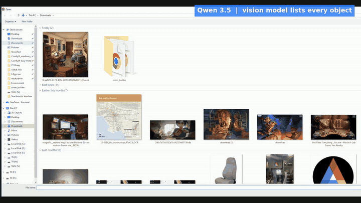
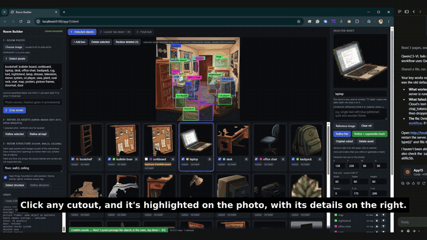
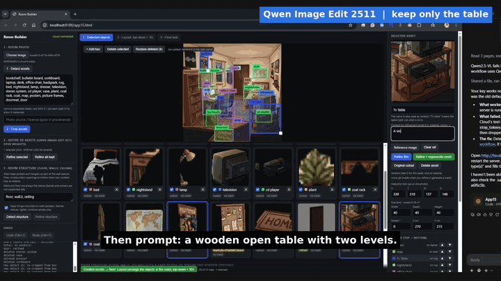
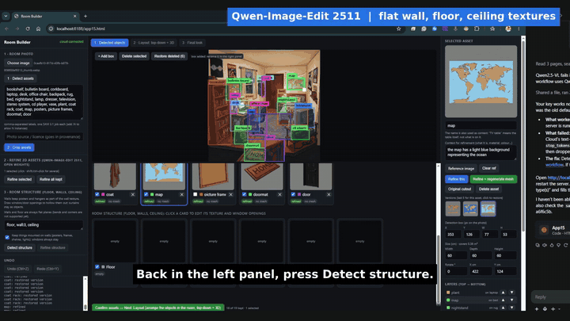
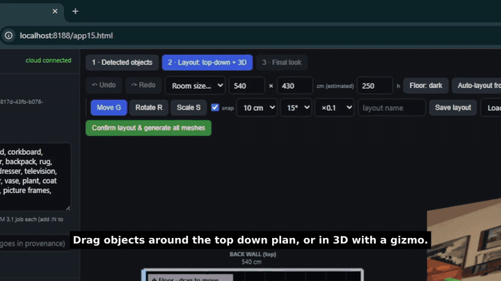
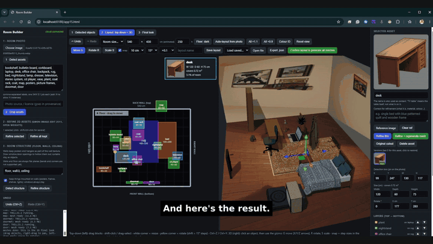

# Native Generation

**One room photo in, an editable 3D scene out.** A node-based ComfyUI Cloud workflow chain behind a single-page editor, built for Comfy Org's Open Source Higgsfield challenge (Most Innovative, Open Weights Only).

**Demo video (2:41):** [media/overview_720p.mp4](media/overview_720p.mp4) | full quality + files: [Drive folder](https://drive.google.com/drive/folders/10QDtZ0z8EQHSNdazV91fKdFCh0FwCaLY) | code: this repo

## Why it exists
Generating one 3D asset from one prompt is a solved demo. Building a whole *scene* from a photo, where every object stays separate, editable and placeable, is the part that makes it usable in production. Each stage is a ComfyUI workflow, so any model can be swapped without touching the rest.

## Walkthrough
| Step | What happens | Model |
|---|---|---|
| 1. Detect assets | A vision-language model lists every object in the photo. | Qwen 3.5 (VLM) |
| 2. Crop assets | One SAM job per label cuts out each object; boxes and cutouts are linked and editable (add, rename, delete). | SAM 3.1 |
| 3. Refine | Each cutout is redrawn as one clean, complete object (e.g. "keep only the table"), so the mesh generator gets isolated geometry, not clutter. | Qwen-Image-Edit 2511 + Lightning LoRA |
| 4. Room structure | Floor, walls and ceiling become flat textures; window and door openings are hollowed out in 3D. | SAM 3.1 + Qwen-Image-Edit |
| 5. Layout | Top-down editor (move, rotate, resize, snap, undo, layers) beside a live 3D view. | in-browser |
| 6. Meshes | A GLB per asset, placed per the saved layout. | TRELLIS.2 |
| 7. Export | `layout.json` with positions, sizes, rotations and provenance. | |

## Architecture
Browser page (`index.html`) -> local Python proxy (`server.py`, holds the API key, never sent to the page) -> ComfyUI Cloud API. Workflow graphs are in `workflows/` (`detect_workflow.json`, `mesh_workflow.json`), so they can be opened and edited in ComfyUI directly. Every asset keeps its source, prompt history and licence field, written to `layout.json`.

## Future scope
- **Engines and DCCs:** a one-click scene export (GLB or USD plus `layout.json`) and small importers: an Unreal Python/Blueprint script that spawns each mesh at its saved transform, a Blender add-on doing the same. Same data would feed Maya or V-Ray for archviz.
- **Virtual production:** photograph a real location or set, get a blocked-out digital twin in minutes for previs, LED-volume backdrops, and camera planning in Unreal.
- **AI video:** render the layout as depth, normal and segmentation passes and feed them to a video model (ControlNet-style) so camera moves stay consistent with real room geometry instead of hallucinating it. Per-object masks allow re-styling one asset without touching the rest.
- **Simulation and robotics:** the labeled, metric-sized scene works as a quick environment for physics sims, navigation tests, and synthetic training data.
- **Games and XR:** user-generated rooms as playable levels; AR placement of a scanned room.
- **Quality:** wall perspective flattening, undo/restore for walls and openings, detecting items on or inside furniture, real-world scale from a reference object.
- **Provenance:** keep per-asset model, version and licence in the export so the chain is auditable (open-weights models only, input photo licence recorded).

## Run
Requires Python 3 and a ComfyUI Cloud account with API access.

    python server.py            # paste your Comfy Cloud API key at the hidden prompt
    # open http://localhost:8188
    python server.py --mock     # fake backend for UI testing (needs Pillow)

The key stays in `server.py` (env `COMFY_API_KEY` also works); the page never sees it. Never commit a key.

## Models (all open weights)
SAM 3.1 (SAM License), Qwen-Image-Edit 2511 (Apache-2.0), TRELLIS.2 (check weights licence). Workflows are in `workflows/`.

## Status
Detect, refine, layout editor and 3D view work. Mesh output retrieval from Comfy Cloud is still being fixed.
Sizes are estimated from typical per-category sizes; edit them if known.

## Provenance
Record the input photo's source and licence in the page's licence field; it is written to `layout.json`.

MIT licence (code).
